# Orbyte

[](https://github.com/SimaoDanielRibeiro/orbyte/actions/workflows/ci.yml)
[](LICENSE)


Laboratório de machine learning para aprender. Carregas um dataset, escolhes um tipo de
aprendizagem e um algoritmo (ou pedes aos agentes que o procurem), e vês o treino passo a passo,
as métricas de avaliação, as explicações das previsões e o registo de cada experiência.

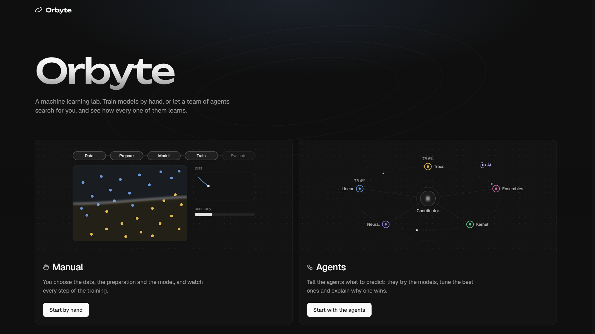

## Instalação rápida

Precisas de três programas: o [Git](https://git-scm.com/downloads), o
[uv](https://docs.astral.sh/uv/getting-started/installation/) (que traz o Python) e o
[Node.js](https://nodejs.org/) 24.16 ou mais recente. Depois, num terminal:

```bash
git clone https://github.com/SimaoDanielRibeiro/orbyte.git
cd orbyte
uv run python scripts/dev.py
```

Da primeira vez, o último comando instala tudo sozinho (o Python 3.12, as bibliotecas e a
interface: uns minutos) e, quando estiver pronto, abre o Orbyte no browser, em
<http://localhost:5173>. `Ctrl+C` pára. Para atualizar mais tarde: `git pull` e o mesmo comando.

Os comandos para instalar o uv e o Node.js em cada sistema, e o que fazer se alguma coisa
falhar, estão em [Começar](#começar).

## O que dá para fazer

- **Treinar à mão:** carregar um dataset (CSV, Excel, JSON, Parquet ou um dos exemplos),
  explorá-lo, prepará-lo e treinar um dos 34 modelos, com a fronteira de decisão a mover-se
  época a época.
- **Pedir aos agentes:** um agente de dados, um por família de modelos e um coordenador procuram
  o melhor modelo com validação cruzada, e dizem por palavras o que mediram. Com o
  [Ollama](https://ollama.com/), um agente de IA propõe hiperparâmetros a pensar à vista, e um
  analista responde, numa conversa, a perguntas sobre a procura.
- **Perceber o modelo:** cada métrica com a fórmula e a conta do run, a história do treino e
  as explicações das previsões (o que pesa, como uma feature muda a previsão, porque saiu uma).
- **Aprender:** seis demonstrações no Lab, o glossário das métricas e o reinforcement learning
  numa grelha (Q-learning e DQN).
- **Guardar:** cada treino fica no History, para comparar e repetir, e um modelo guarda-se num
  ficheiro `.mllab` (com o ONNX) que se carrega noutra instalação.

<table>
  <tr>
    <td width="50%" valign="top">
      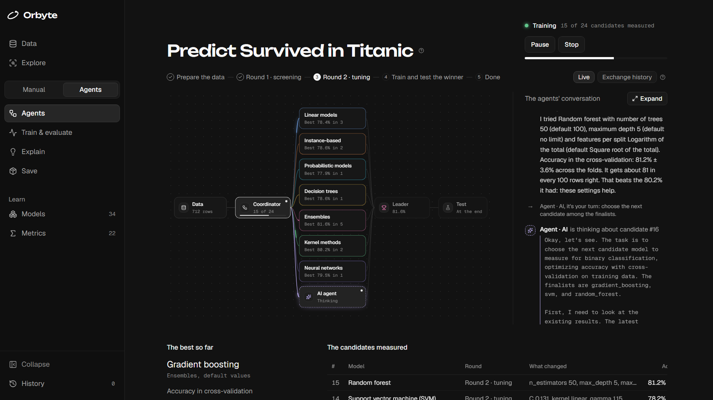
      <p><b>Os agentes a trabalhar.</b> Uma procura no Titanic: o fluxograma acende quem está a
      trabalhar (aqui, o agente de IA a pensar no próximo candidato), e a conversa diz o que cada
      um mediu e decidiu.</p>
    </td>
    <td width="50%" valign="top">
      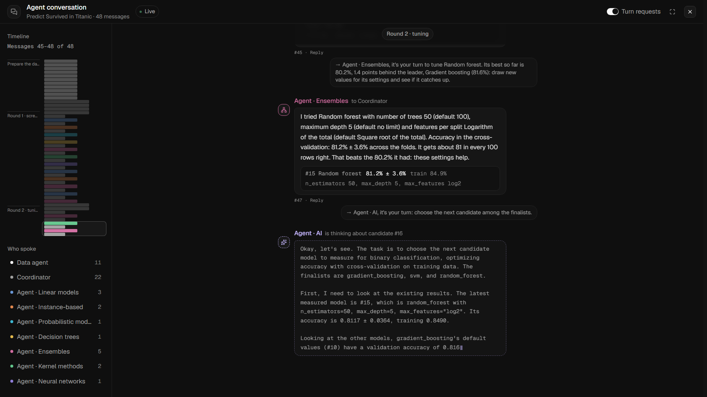
      <p><b>A conversa dos agentes, em grande</b> ("Expand"): as mensagens de cada fase, quem fala
      com quem, e a linha do tempo para saltar.</p>
    </td>
  </tr>
  <tr>
    <td width="50%" valign="top">
      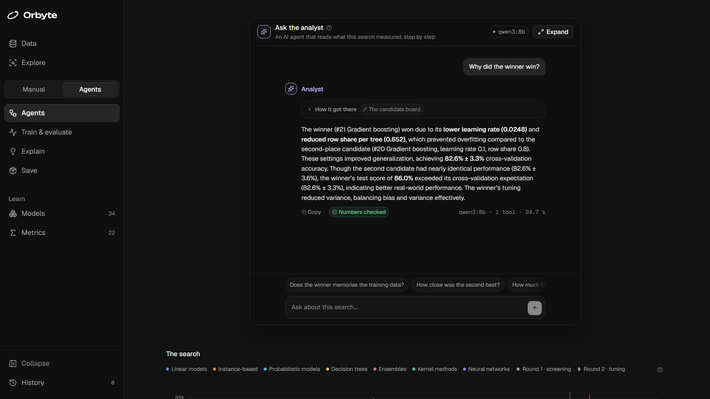
      <p><b>O analista.</b> Uma conversa sobre a procura acabada, com um modelo de linguagem local
      (o Ollama): lê o quadro, compara candidatos e responde com números verificados.</p>
    </td>
    <td width="50%" valign="top">
      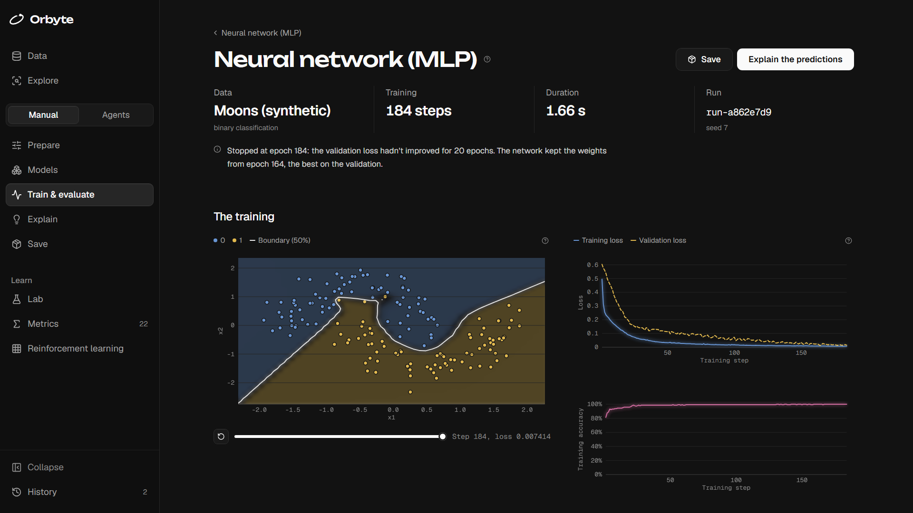
      <p><b>Treinar à mão.</b> Uma rede neuronal nas luas: a fronteira de decisão em cada
      fotografia do treino, e as curvas da loss e da exatidão.</p>
    </td>
  </tr>
  <tr>
    <td width="50%" valign="top">
      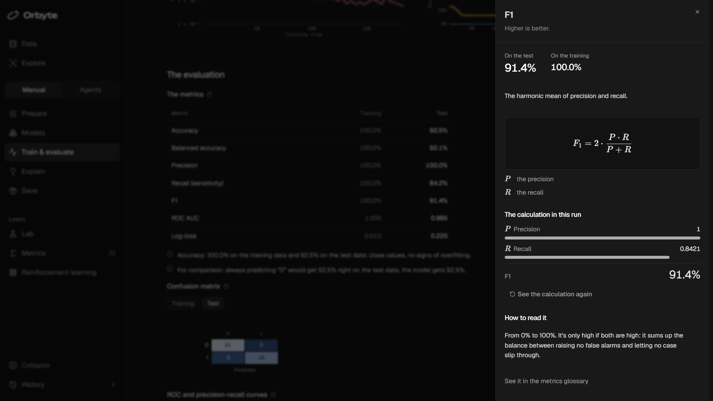
      <p><b>Cada métrica com a sua conta.</b> A fórmula do F1 e os números deste run, passo a
      passo.</p>
    </td>
    <td width="50%" valign="top">
      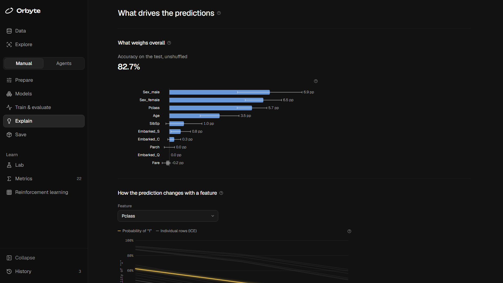
      <p><b>Explicar as previsões.</b> O que pesa no conjunto (a importância por permutação), como
      a previsão muda com uma feature e porque saiu uma previsão.</p>
    </td>
  </tr>
  <tr>
    <td width="50%" valign="top">
      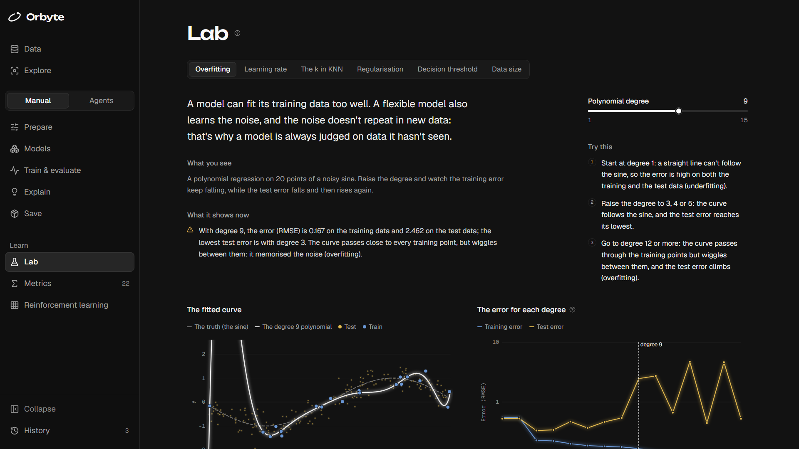
      <p><b>O Lab.</b> Seis demonstrações, cada uma com um controlo; aqui, um polinómio de grau 9 a
      decorar o ruído (overfitting).</p>
    </td>
    <td width="50%" valign="top">
      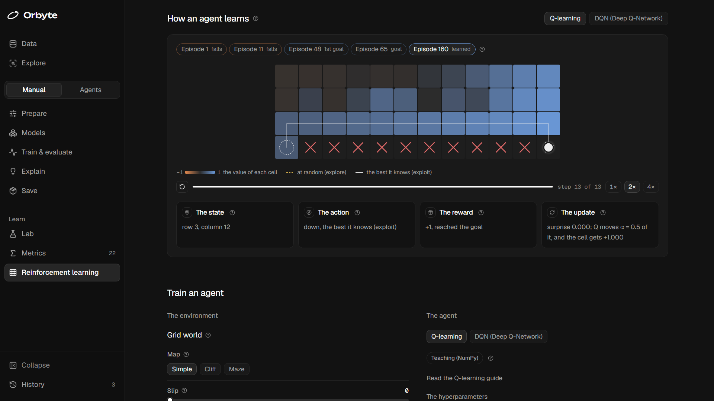
      <p><b>Reinforcement learning.</b> A lição do Q-learning no penhasco, episódio a episódio,
      com o valor que o agente dá a cada célula.</p>
    </td>
  </tr>
  <tr>
    <td width="50%" valign="top">
      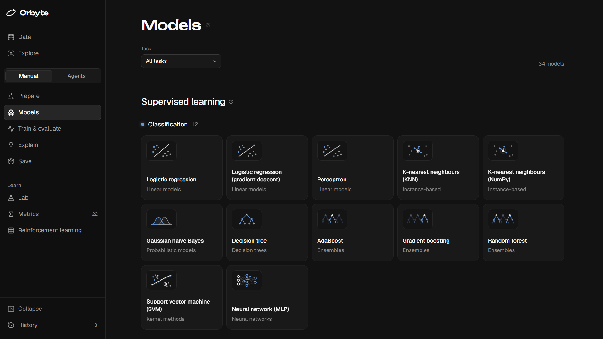
      <p><b>34 modelos</b>, cada um com a ficha, um exemplo a aprender e os hiperparâmetros
      explicados.</p>
    </td>
    <td width="50%" valign="top">
      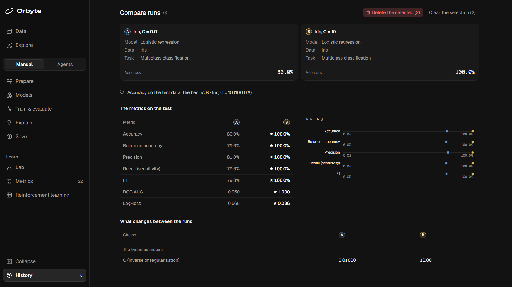
      <p><b>O History.</b> Dois runs lado a lado, com o melhor marcado e só o que mudou entre
      eles.</p>
    </td>
  </tr>
</table>

As imagens tiram-se sozinhas, com `npm run screenshots` em `ui/web` (ver
[ui/web/README.md](ui/web/README.md)).

Chamava-se ML Lab: o site passou a Orbyte, todo em inglês, e o pacote Python continua a ser
`ml_lab` (ADR 0043). O plano completo está em [docs/architecture.md](docs/architecture.md); as
decisões e as suas razões, em [docs/adr/](docs/adr/); e cada algoritmo tem a sua ficha didática
em [docs/algorithms/](docs/algorithms/).

## Começar

O Orbyte corre no teu computador, sem contas nem servidores de fora: no Windows (x64), no macOS
(Apple Silicon, do M1 em diante) e no Linux (x64 ou ARM64). São três passos, e o primeiro só se
faz uma vez.

### 1. Instalar o que é preciso

- **[Git](https://git-scm.com/downloads)**, para descarregar o projeto.
- **[uv](https://docs.astral.sh/uv/)**, que instala o Python 3.12 e as bibliotecas do backend
  sozinho (não é preciso ter o Python instalado):

  ```powershell
  # Windows (PowerShell)
  powershell -ExecutionPolicy ByPass -c "irm https://astral.sh/uv/install.ps1 | iex"
  ```

  ```bash
  # macOS e Linux
  curl -LsSf https://astral.sh/uv/install.sh | sh
  ```

- **[Node.js](https://nodejs.org/) 24.16 ou mais recente** (traz o npm), para a interface: o
  instalador da versão LTS chega.
- Opcional: o **[Ollama](https://ollama.com/)**, para os agentes de IA e o analista, com o
  modelo `qwen3:8b` (`ollama pull qwen3:8b`, uns 5 GB). Sem ele, tudo o resto funciona, e o
  ecrã Agents diz como o ligar.

Depois de os instalar, abre um terminal novo: é ele que encontra os programas acabados de
instalar.

### 2. Descarregar o projeto

```bash
git clone https://github.com/SimaoDanielRibeiro/orbyte.git
cd orbyte
```

Os datasets de exemplo (Iris, Wine, Titanic e California Housing) já vêm no repositório, em
`data/samples/`. Para os voltar a descarregar das origens, com verificação SHA-256:
`uv run python scripts/download_samples.py --force`.

### 3. Abrir o Orbyte

A interface é uma aplicação web (React, em `ui/web`) que fala com o backend pela API. Um só
comando, a partir da pasta do projeto, instala o que faltar e arranca as duas:

```bash
uv run python scripts/dev.py
```

Da primeira vez, o `uv run` cria o ambiente virtual em `.venv/` e instala as versões exatas do
`uv.lock` (o mesmo que um `uv sync`): as bibliotecas do backend, as ferramentas de
desenvolvimento e o pacote `ml_lab`, em modo editável (as alterações em `src/` ficam ativas sem
reinstalar). Demora uns minutos, sobretudo pelo PyTorch: no Windows e no macOS vem a versão só
para o processador, que chega para as redes do laboratório; no Linux vem com as bibliotecas do
CUDA (uns 3 GB a descarregar).

Depois, o `scripts/dev.py` confirma que o Node.js é o 24.16 ou mais recente e que as portas 8000 e
5173 estão livres, instala as dependências da interface (`npm ci`, em `ui/web`) da primeira vez
e sempre que um `git pull` as mude, e arranca a API e a interface. Quando as duas respondem,
diz "Pronto" e abre <http://localhost:5173> no browser (com `--no-browser`, não abre). Só este
computador lhes tem acesso. A interface recarrega sozinha quando gravas um ficheiro, e `Ctrl+C`
pára as duas.

### Se alguma coisa falhar

| O que aparece | O que fazer |
|---|---|
| `uv`, `git`, `node` ou `npm` não é reconhecido (`command not found`) | Abre um terminal novo depois de os instalar; no Windows, se não chegar, termina a sessão e volta a entrar. |
| "O Node.js deste computador é o 20…" (ou o 24.15…) | Instala a versão LTS do Node.js (a 24.16 ou mais recente), de <https://nodejs.org>, e abre um terminal novo. Até ao 24.15, no Windows, o Node.js ia abaixo sem aviso quando abria muitas ligações seguidas, como faz a interface a falar com a API (ADR 0056). |
| "A porta 8000 (da API) já está ocupada" | O Orbyte já está a correr noutro terminal: fecha-o (`Ctrl+C`). Ou muda a porta da API no `.env` (`ML_LAB_API_PORT=8010`); a interface segue-a sozinha. |
| "A porta 5173 (da interface) já está ocupada" | Outro servidor do Vite está aberto: fecha-o e corre outra vez. |
| O `npm ci` falha no Windows com `EPERM` | Um servidor da interface ainda está a correr dessa pasta e prende os ficheiros do `node_modules`: fecha-o e corre outra vez. |
| O `uv` não encontra o `torch` num Mac com Intel ou num Windows em ARM | O PyTorch deixou de ter versões para eles: o Orbyte precisa de um Mac com Apple Silicon ou de um PC x64 (ou ARM64 com Linux). |
| O browser abriu, mas a página diz que a API não responde | Recarrega a página: a API pode ainda estar a acabar de arrancar. Se continuar, os erros dela estão no terminal. |
| O ecrã Agents diz que o Ollama não está a correr | Abre o Ollama (ou `ollama serve`, num terminal) e descarrega o modelo: `ollama pull qwen3:8b`. |

Para atualizar depois um projeto já descarregado: `git pull` e o mesmo
`uv run python scripts/dev.py`, que trata do resto.

A página de entrada tem os dois caminhos, "Start by hand" e "Start with the agents". Na barra
lateral, os primeiros passos (**Data** e **Explore**) são dos dois; por baixo troca-se entre
**Manual** e **Agents**, e seguem os passos de cada um:

- o **Manual**: Prepare, Models, "Train & evaluate", Explain e Save, e, para aprender, o Lab,
  as Metrics e o Reinforcement learning;
- os **Agents**: Agents, "Train & evaluate", Explain e Save, e, para aprender, os Models e as
  Metrics.

Os dois acabam nos mesmos ecrãs, e cada treino fica no **History**. Em cada passo, o botão
branco (em cima, à direita) leva ao seguinte. `Ctrl K` procura um ecrã, um modelo ou uma
métrica, e as explicações estão no "?" ao lado de cada título.

### Os dados que aceita

Em **Data** carrega-se um ficheiro, um dos exemplos ou um dataset sintético (as luas, os
círculos, as anomalias…). Os ficheiros podem ser:

- CSV, TSV ou TXT, separados por vírgulas, ponto e vírgula, tabulações ou `|` (o separador e a
  codificação detetam-se sozinhos), também comprimidos em `.gz`;
- Excel (`.xlsx`, `.xlsm` e o antigo `.xls`): lê-se a primeira folha;
- JSON: uma lista de registos, um registo por linha (`.jsonl`), os registos dentro de uma
  chave (`{"data": [...]}`) ou as colunas (`{"idade": [...]}`); os objetos aninhados passam a
  colunas como `morada.cidade`;
- Parquet (`.parquet`, `.pq`): o tipo de cada coluna já vem no ficheiro (as categorias, os
  inteiros com nulos e as datas com fuso passam aos tipos de um CSV), e o índice com nome volta
  como coluna.

Até 200 MB. Os números com vírgula decimal, as datas e os "Sim"/"Não" guardados como texto
convertem-se na limpeza, com a razão de cada passo; os identificadores, as colunas vazias ou
constantes e os preços impossíveis no alvo (um erro de digitação) vêm sugeridos para sair.

### Um percurso à mão

Em **Data**, carrega o exemplo Titanic e vê o tipo de cada coluna e porquê; em **Explore**, o
perfil das colunas e os avisos (77% de nulos em `Cabin`, `PassengerId` é um identificador); em
**Prepare**, o alvo `Survived` e as limpezas sugeridas já vêm escolhidos, e ao lado vês a
linhagem, a divisão e a projeção 2D. Carrega em "Choose the model": em **Models**, abre a
regressão logística, lê a ficha, vê-a aprender num exemplo enquanto mudas os hiperparâmetros e
carrega em "Train with these values". No **Train & evaluate** vês o treino ao vivo e, no fim,
a fronteira de decisão no plano da projeção, as métricas no treino e no teste (carrega no nome
de uma para ver a fórmula e a conta deste run), a matriz de confusão e os pesos que o modelo
aprendeu. Experimenta baixar o `C` e treinar outra vez.

Para ver o treino passo a passo: em **Data**, gera as "Moons" e prepara-as; em **Models**, abre
a regressão logística com gradiente descendente e treina. No **Train & evaluate**, a fronteira
move-se época a época, com a loss a descer, e o controlo ao lado percorre as fotografias uma a
uma. Com treinos longos, o ecrã mostra o progresso ao vivo, com Pause, Resume e Stop.

Para avaliar a fundo e explicar, treina um classificador: a avaliação tem a matriz de
confusão, as curvas ROC e de precisão-recall e os pontos onde o modelo erra, no plano. "Run the
cross-validation" treina o modelo 5 vezes, e "Draw the learning curve" mostra como ele muda com
mais dados. "Explain the predictions" abre o **Explain**, com a história do treino e três
perguntas: o que pesa no conjunto (a importância por permutação), como a previsão muda com uma
feature (a dependência parcial) e porque saiu uma previsão concreta.

Para aprender sem alvo, carrega o Iris e, em **Prepare**, mantém o alvo `species` mas escolhe a
tarefa de clustering: a coluna deixa de entrar no treino e fica como referência. Treina a
mistura de gaussianas e vê as elipses a ajustarem-se, iteração a iteração.

### Com os agentes

Em **Data**, carrega o Titanic e troca para **Agents**. O alvo `Survived` já vem escolhido; em
"The models" escolhes que modelos os agentes podem experimentar (todos, à partida) e, por
baixo, vês o plano do agente de dados, com a razão de cada escolha. Carrega em "Ask the
agents": o fluxograma mostra quem trabalha, e a conversa dos agentes explica, por palavras, o
que cada um mediu e decidiu. "Stop" pára tudo e volta ao pedido. No fim ficam o vencedor (a
validação cruzada escolheu-o; o teste usa-se uma só vez), o quadro dos candidatos e o
histórico das trocas. "Open the winner" leva-o para o **Train & evaluate**, como um run feito à
mão, e "Train in manual mode" treina qualquer candidato do quadro.

Com o Ollama aberto, "Ask the analyst" conversa contigo sobre a procura acabada: pergunta "Why
did the winner win?" e vês o analista ler o quadro inteiro (todos os candidatos e todos os
modelos), comparar o vencedor com o segundo e responder, com cada número verificado (o selo
"Numbers checked"). Só a conversa desliza, dentro do painel, e "Expand" abre-a em ecrã inteiro,
como num chat; os passos de cada resposta abrem-se pelo que ele fez, com o que cada ferramenta
devolveu e o raciocínio que a pediu.

### Para aprender

- **Lab**: seis demonstrações, cada uma com um controlo, o que experimentar e o que fica — o
  overfitting, a taxa de aprendizagem, o k do KNN, a regularização, o limiar de decisão e a
  quantidade de dados.
- **Metrics**: o glossário das métricas, cada uma com a fórmula e o que mede.
- **Reinforcement learning**: escolhe o mapa "Cliff" e o Q-learning e carrega em "Train the
  agent"; na grelha, o valor espalha-se a partir do objetivo, episódio a episódio. "How an agent
  learns" mostra a lição de cada agente (o Q-learning e o DQN), como um timelapse.
- **Save**: em três passos (o run, o que vai no ficheiro e o próprio ficheiro, parte a parte),
  guarda um modelo num `.mllab`; a biblioteca, por baixo, carrega um modelo já treinado (o que
  vem de outra instalação só abre depois de confirmares que confias nele).

No **History**, marca dois runs para os comparar lado a lado, com o melhor marcado e só as
escolhas que mudaram. Pára a API e arranca-a outra vez: os runs continuam lá, e "Replay" treina
outra vez a mesma configuração. Para apagar, o caixote do lixo ao fim de cada linha apaga esse
run, e "Delete the selected" apaga os que estão marcados (os dois pedem confirmação: não se
desfazem).

## Usar a API

A API põe os serviços a falar HTTP, e é por ela que a interface chega ao backend. Para a correr
sozinha:

```bash
uv run python -m ml_lab.api
```

A documentação interativa fica em <http://127.0.0.1:8000/docs>. Lá dá para:

1. enviar um ficheiro (`POST /datasets/uploads`);
2. começar um treino (`POST /experiments`, que responde logo com o `run_id`);
3. acompanhar o treino (`GET /experiments/{run_id}/updates`, com os passos e a fronteira de
   cada snapshot);
4. pedir o resultado (`GET /experiments/{run_id}/result`).

O WebSocket `/experiments/{run_id}/stream` envia o mesmo que o passo 3, sozinho. O
reinforcement learning tem as mesmas rotas, em `/reinforcement`, e os agentes também, em
`/automl`. Os pormenores estão em [src/ml_lab/api/README.md](src/ml_lab/api/README.md).

O contrato da API fica guardado em `ui/web/openapi.json`, de onde se gera o cliente TypeScript,
e o guia do contrato está em [ui/web/README.md](ui/web/README.md). Depois de mudar um serviço,
uma rota ou um tipo devolvido, volta a gerá-lo:

```bash
uv run python scripts/export_openapi.py
```

## Testes e verificações

São mais de 2500 testes: 2435 do backend (1014 de unidade, 1278 de contrato, 15 de
arquitetura, 62 de integração e 66 da API, dois deles com o Ollama a sério), 72 das peças da
interface e 51 de ponta a ponta, num browser.

Uma fase só termina quando estas verificações passam (corre-as antes de cada push; o GitHub
Actions corre-as também, em `.github/workflows/ci.yml`):

```bash
uv run ruff format --check .
uv run ruff check .
uv run mypy
uv run pytest
```

Para um ciclo rápido, sem os testes de integração e da API:

```bash
uv run pytest -m "not integration and not api"
```

A interface tem as suas, dentro de `ui/web` (o `check` gera o cliente e corre o lint, os tipos
e os testes; o `e2e` abre a interface num browser, com a API numa pasta temporária):

```bash
npm run check
npm run e2e
```

| Pasta | O que verifica | Quando corre |
|---|---|---|
| `tests/unit/` | Uma função ou classe isolada; espelha `src/ml_lab/` | Sempre |
| `tests/contract/` | Todos os componentes registados cumprem o seu contrato (modelos, métricas, fontes de dados, limpezas, divisões, agentes e ambientes) e a fronteira dos serviços passa a JSON | Sempre |
| `tests/architecture/` | Regras de importação entre camadas | Sempre |
| `tests/integration/` | Fluxos de ponta a ponta: o critério de cada fase, nos serviços | Antes de cada push |
| `tests/api/` | Endpoints HTTP e WebSocket | Antes de cada push |
| `ui/web/src/` (`*.test.ts`, `*.test.tsx`) | As peças da interface | Sempre (`npm run check`) |
| `ui/web/e2e/` | A interface num browser, ecrã a ecrã (Playwright), com a verificação de acessibilidade | Antes de cada push (`npm run e2e`) |

Os avisos (`warnings`) contam como erros nos testes: um aviso do pandas ou do scikit-learn
costuma anunciar um problema real, por isso é melhor resolvê-lo logo.

## Configuração

Os valores por omissão chegam para começar. Para mudar alguma coisa, copia `.env.example`
para `.env` e edita-o, ou define variáveis de ambiente (que têm prioridade sobre o `.env`).

| Variável | Para que serve | Omissão |
|---|---|---|
| `ML_LAB_UPLOADS_DIR` | Datasets carregados pelo utilizador | `data/uploads` |
| `ML_LAB_ARTIFACTS_DIR` | Modelos treinados, snapshots e pacotes | `artifacts` |
| `ML_LAB_DATABASE_PATH` | Ficheiro SQLite do registo de experiências | `artifacts/ml_lab.db` |
| `ML_LAB_LOG_LEVEL` | Nível mínimo dos logs | `INFO` |
| `ML_LAB_LOG_FORMAT` | `text` (terminal) ou `json` (logs estruturados) | `text` |
| `ML_LAB_API_HOST` | Onde a API escuta (`127.0.0.1` é só este computador) | `127.0.0.1` |
| `ML_LAB_API_PORT` | A porta da API | `8000` |
| `ML_LAB_API_CORS_ORIGINS` | As páginas que podem chamar a API a partir do navegador | o servidor do Vite |
| `ML_LAB_OLLAMA_URL` | Onde o Ollama escuta (os agentes de IA) | `http://127.0.0.1:11434` |
| `ML_LAB_OLLAMA_MODEL` | O modelo do Ollama que os agentes de IA usam | `qwen3:8b` |

A API não tem autenticação: fica só neste computador. Os uploads, a base de dados, os runs, os
pacotes e a chave que os assina (`artifacts/package.key`) ficam fora do Git.

## Estrutura

```text
src/ml_lab/          pacote instalável
├── config.py        definições: caminhos, base de dados, logs, API, Ollama
├── logging.py       logs estruturados
├── core/            núcleo: não importa api/ nem bibliotecas de interface
│   ├── foundation/  tipos, erros, registo de componentes, eventos, seeds
│   ├── data/        camada de dados: as nove etapas (o único sítio com pandas)
│   ├── models/      algoritmos: um ficheiro = um modelo
│   ├── rl/          reinforcement learning: ambientes e agentes
│   ├── automl/      os agentes: dados, um por família, o de IA e o coordenador
│   ├── llm/         os modelos de linguagem dos agentes de IA (o Ollama)
│   ├── services/    a única porta de entrada do núcleo
│   └── ...          training, evaluation, explainability, tracking, export...
└── api/             FastAPI: uma rota por método dos serviços
ui/web/              a interface (React + TypeScript)
tests/               unit, contract, integration, architecture, api
data/samples/        datasets de exemplo (versionados)
scripts/             utilitários: arrancar a API e a interface, descarregar os exemplos…
docs/                arquitetura, ADRs, o formato .mllab e as fichas dos algoritmos
```

A árvore completa, com o papel de cada ficheiro, está em
[docs/architecture.md](docs/architecture.md#estrutura-de-pastas). Cada camada tem um
`README.md` curto com as suas regras.

## Estado das fases

O laboratório fez-se fase a fase, cada uma com o seu critério de "pronto" (o plano está em
[docs/architecture.md](docs/architecture.md#roadmap-por-fases)).

| Fase | O que entrega | Estado |
|---|---|---|
| 0 — Fundações | Repositório, configuração, logs, registo de componentes, tipos, eventos, seeds, testes de arquitetura | ✅ concluída |
| 1 — Camada de dados | As nove etapas da camada de dados; ecrãs Data, Explore e Prepare | ✅ concluída |
| 2 — Primeiro fluxo completo | Contrato de modelo, regressão logística, avaliação de classificação, serviço de experiências | ✅ concluída |
| 3 — Eventos e snapshots | Contexto de treino, snapshots com a fronteira de decisão, treino em segundo plano, regressões didáticas em NumPy | ✅ concluída |
| 4 — Catálogo clássico | Os modelos supervisionados e não supervisionados, avaliadores de todas as tarefas, diagnósticos, validação cruzada, explicações das previsões | ✅ concluída |
| 5 — Memória | Registo de experiências em SQLite, runs guardados com o modelo, comparação e reprodução de runs | ✅ concluída |
| 6 — Deep learning | Adaptador PyTorch, rede neuronal (MLP) de classificação e de regressão, early stopping, gradientes e ativações de cada camada | ✅ concluída |
| 7 — API | Os serviços por HTTP com FastAPI (uma rota por método, documentação em `/docs`), treino acompanhado por HTTP ou WebSocket, erros com um código e uma mensagem que diz o que fazer | ✅ concluída |
| 8 — Reinforcement learning | Uma grelha com três mapas, Q-learning (NumPy) e DQN (PyTorch), a política aprendida, uma lição por agente, runs no histórico | ✅ concluída |
| 9 — Agentes (AutoML) | Um agente de dados, um agente por família de modelos e um coordenador que procura o melhor modelo com validação cruzada, sem tocar no teste | ✅ concluída |
| 10 — Interface aprimorada | Todos os ecrãs em React, por cima da API, nas etapas 10.1 a 10.9; a interface simples, em Streamlit, saiu depois dela (ADR 0031) | ✅ concluída |
| 11 — Guardar e carregar o modelo | O pacote `.mllab` (a ficha, o manifesto assinado, a preparação, o run, o modelo e o ONNX), a biblioteca e o carregar com aviso | ✅ concluída |
| 12 — Prever | Prever com um pacote, linha a linha ou um CSV inteiro | por fazer |
| 13 — Agentes de IA | Um modelo de linguagem local (Ollama) que propõe hiperparâmetros a pensar à vista, e um analista que responde sobre a procura numa conversa, com ferramentas; as regras continuam a medir (ADR 0042, 0053, 0054 e 0057) | ✅ concluída |

## Convenções

- Nomes de código em inglês; documentação, docstrings e commits em português de Portugal; o
  site todo em inglês (ADR 0043).
- Tipos em todas as funções públicas, verificados com `mypy --strict`.
- Docstrings no estilo Google.
- Imports sempre absolutos (`from ml_lab.core.foundation.types import TaskType`).
- Ramo `main` sempre a funcionar; trabalho em ramos `feat/...` e `fix/...`.
- Mensagens de commit no formato Conventional Commits (`feat: adiciona k-means didático`).
- Cada decisão que não seja óbvia fica registada numa ADR em `docs/adr/`.
- O backend escreve-se pronto para o frontend: os serviços devolvem dados simples que
  passam a JSON, e as regras de domínio e os textos didáticos ficam no backend. As regras
  completas estão em [CONTRIBUTING.md](CONTRIBUTING.md).

Para acrescentar um algoritmo, uma métrica, uma fonte de dados ou um tipo de tarefa, segue
[Manutenção: como adicionar componentes](docs/architecture.md#manutenção-como-adicionar-componentes).

## Licença

[MIT](LICENSE): podes usar, copiar, mudar e distribuir o código, também em projetos fechados ou
comerciais, desde que o aviso de copyright e a licença vão com ele. O código vem sem garantias.
Os datasets de exemplo em `data/samples/` não são abrangidos por ela: vêm de outras origens,
com os seus próprios termos, citadas em [data/samples/README.md](data/samples/README.md).
