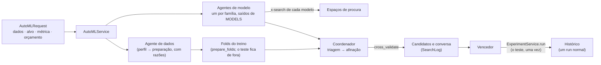

# 0025 — Agentes de AutoML deterministas, por cima dos serviços

- **Estado:** Proposta
- **Data:** 2026-10-25

## Contexto

Até à fase 8, escolher um modelo era sempre manual: preparar os dados, escolher um algoritmo,
treinar, avaliar e repetir. A fase 9 junta um **modo automático**: dizer o que se quer prever
e deixar "agentes" pegar no dataset, tratá-lo e experimentar os modelos, um agente por tipo de
modelo, até encontrar o que melhor faz a tarefa. O modo manual fica ao lado, para avaliar e
perceber cada escolha.

As forças em jogo:

- **é um projeto para aprender**: cada decisão dos agentes tem de vir com a razão, e o
  resultado tem de se poder repetir;
- **a avaliação tem de ser honesta**: quem escolhe entre dezenas de candidatos pelo teste
  escolhe o que teve mais sorte nele, e a nota final deixa de dizer como o modelo se porta em
  dados novos;
- **manutenção**: um modelo novo não pode obrigar a mexer nos agentes;
- **o backend tem de ficar pronto para o frontend** (ADR 0019 e 0022): a procura corre em
  segundo plano e acompanha-se pelo mesmo contrato dos treinos;
- **sem tecnologias novas**: o scikit-learn, o PyTorch e a validação cruzada da fase 4 chegam.

## Decisão

Os agentes são **regras e medições, sem modelos de linguagem**, e vivem em `core/automl/`.
O serviço `AutoMLService` liga-os aos outros serviços:

1. **O agente de dados** decide a preparação a partir do perfil, nunca das linhas: aceita as
   sugestões de limpeza, confirma a tarefa, divide com 20% para o teste (estratificado com
   classes), preenche os nulos, faz o one-hot e padroniza. Com classes desequilibradas,
   sugere otimizar a exatidão equilibrada. Uma preparação feita à mão é adotada tal como está.
2. **Há um agente de modelo por família**, gerado a partir do registo `MODELS`: um modelo
   novo entra no agente da sua família sem mudar nada em `core/automl/`. Ficam de fora, com a
   razão, as implementações didáticas que têm versão das bibliotecas na família e, se a
   métrica medir probabilidades, os modelos que não as dão.
3. **O espaço de procura vive no próprio modelo**, numa extensão do JSON Schema dos
   hiperparâmetros: `"x-search": {"values": [...]}` ou `{"range": [mínimo, máximo]}` (na
   escala do `x-scale`). Os hiperparâmetros sem `x-search` ficam com o valor por omissão. Um
   teste de contrato confirma que todos os valores que os agentes podem sortear são válidos.
4. **O coordenador faz duas rondas** com um orçamento contado em candidatos:
   - a **triagem**: cada modelo com os valores por omissão, uma família de cada vez, com a
     referência (o modelo sugerido para a tarefa) à frente;
   - a **afinação**: os finalistas, à vez, com combinações sorteadas do seu espaço (procura
     aleatória), sem repetir nenhuma.

   Cada candidato mede-se com **validação cruzada nos folds do treino**. O coordenador só
   recebe os folds: não tem como ver o teste. O vencedor é a melhor média; num empate, o
   menor desvio padrão, e depois o que veio primeiro.
5. **O vencedor treina como um run normal** do `ExperimentService`, com o treino todo e a
   mesma seed: é aí, e só aí, que o teste se usa. O run fica no histórico, com um nome que diz
   que veio dos agentes, e abre-se no Avaliar e no Explicar como qualquer outro.
6. **A procura é um trabalho em segundo plano** como os treinos (ADR 0014 e 0022): cada
   candidato medido é um passo do `TrainingJob`, que pausa e pára no fim do candidato atual
   (parar dá o melhor até aí). O `SearchLog` guarda a conversa dos agentes e os candidatos,
   numerados, e `updates(search_id, after_step, after_message)` devolve só o que é novo; o
   WebSocket usa o mesmo pedido.
7. **A ponte para o modo manual** é `train_candidate`: qualquer candidato do quadro treina
   como um run normal, para se ver por dentro no ecrã Treinar.
8. **Só tarefas com alvo** (classificação e regressão): sem previsões certas para comparar, o
   clustering e as outras tarefas sem alvo ficam no modo manual, e o serviço diz porquê.

## Consequências

- Com a mesma seed, a procura repete-se tal e qual (a divisão, os folds, os sorteios e o
  vencedor), e cada passo está explicado em português na conversa dos agentes.
- A nota do teste do vencedor é honesta: nenhuma escolha a viu. A diferença entre a
  validação cruzada e o teste, que o resultado comenta, ensina o otimismo do vencedor.
- Um modelo novo entra na procura sozinho; para ser afinado, declara o `x-search`.
- Os datasets grandes procuram-se numa amostra do treino (`max_rows`, por omissão 2 000
  linhas), para a procura demorar segundos e não minutos; o vencedor treina com todas.
- Fica de fora, como extensão: medir os candidatos em paralelo; procuras adaptativas
  (successive halving, otimização bayesiana, ou um bandido multibraço a dar o orçamento a
  quem promete mais, primo do ε-greedy da fase 8); uma preparação diferente por família;
  guardar a procura inteira no registo (hoje fica em memória, e só o vencedor vai para o
  histórico).
- Um orquestrador com um modelo de linguagem pode vir depois, por cima disto: os métodos
  do serviço já são as "ferramentas" de que precisaria, e as decisões continuariam a ser
  medidas pelo coordenador.
- A interface aprimorada passa para a fase 10. As ADRs 0003, 0005 e 0019 falam da "fase 9":
  era o número dela quando foram escritas.
